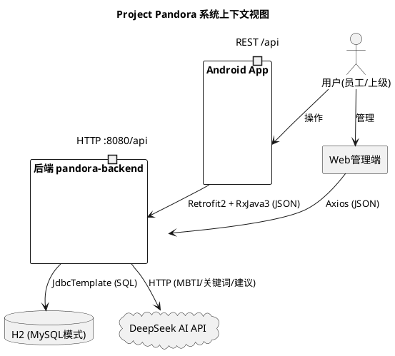
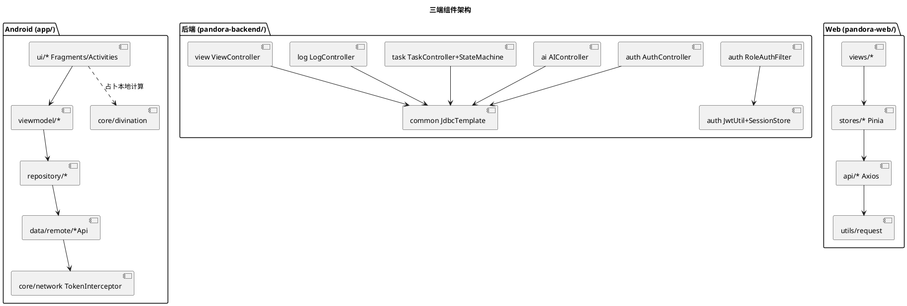
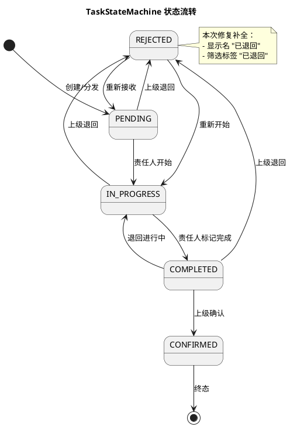
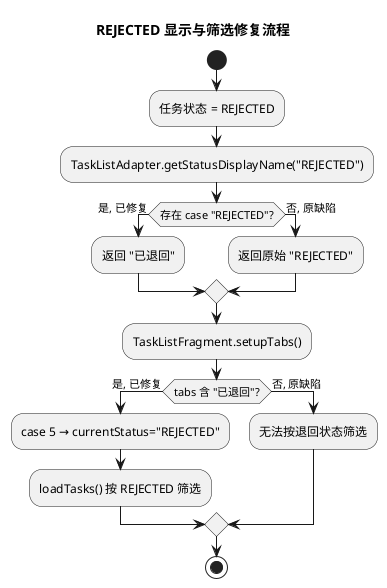
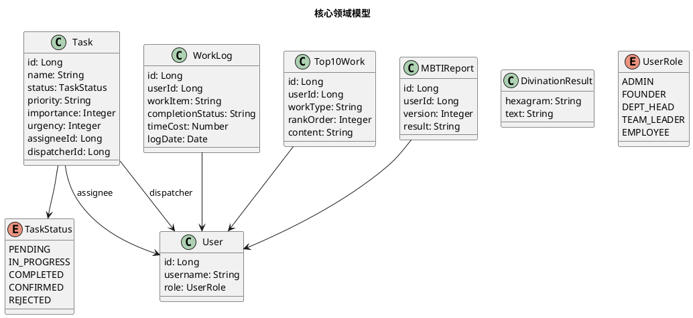

# Design: Initial MVP Delivery

> 本文档为 Project Pandora 初始 MVP 交付的实现方案（技术设计文档）。
> 已基于实际代码逐项核对，修正了原设计文档中与代码不符的 3 处不一致（底部导航名称、后端认证模式、任务状态流转），并将上一阶段修复的 2 处 REJECTED 代码缺陷反映到设计中。

## 架构总览

### Android端 (app/)
- MVVM + Repository 架构（viewmodel/ + repository/ 分层）
- Retrofit2 + RxJava3 网络层（data/remote/ 定义 API 接口，core/network/ 拦截器）
- ViewBinding + DataBinding 数据绑定（buildFeatures 已开启）
- Navigation Component 导航（res/navigation/nav_graph.xml + NavigationUI）
- Material Design 组件 + MPAndroidChart 图表 + Glide 图片加载
- Room（已引入依赖，data/local/ 预留本地缓存）
- compileSdk 36 / minSdk 24 / Java 11

### 后端 (pandora-backend/)
- Spring Boot 3.2.0 + Java 17
- JdbcTemplate 直接 SQL（全部 Controller 使用 JdbcTemplate，无 JPA Entity / @Repository）
- H2 内嵌数据库（MySQL 兼容模式，文件存储 D:/AndroidStudio/Project_Pandora/pandora-data/）
- JWT 无状态认证 + 内存 Session（SessionStore 校验会话有效性）
- Spring Security + 自定义 RoleAuthFilter（JWT 解析 + 角色注入）
- Oracle profile 已预留（application-oracle.yml + ojdbc11 已引入）
- DeepSeek AI 接入（application.yml deepseek 配置）

### Web管理端 (pandora-web/)
- Vue3 (^3.4.0) + Vite5 (^5.0.10) + Element Plus (^2.5.0)
- Pinia (^2.1.7) 状态管理 + Vue Router4 路由
- Axios (^1.6.5) HTTP 客户端
- ECharts (^5.4.3) 图表 + dayjs 时间处理

## 关键设计决策

### 数据库选择
- 开发环境使用 H2 内嵌数据库（MODE=MySQL 兼容模式），文件存储在 D 盘 pandora-data 目录
- Oracle profile 已预留（application-oracle.yml），ojdbc11 驱动已引入 pom，用户安装 Oracle 后可切换
- 建表脚本 h2_schema.sql 使用 CREATE IF NOT EXISTS，配合 spring.sql.init.mode=always 支持重复执行

### 认证模式（已修正）
- **实际状态：认证已启用**（原文档误记为"调试模式/permitAll/已注释"，已修正）
- SecurityConfig：`/auth/login`、`/auth/register`、`/auth/refresh`、`/auth/forgot-password`、`/actuator/**`、`/h2-console/**` 走 permitAll，其余 `anyRequest().authenticated()`
- RoleAuthFilter：完整实现 JWT Bearer Token 解析 → JwtUtil.validateToken → SessionStore 会话比对 → SecurityContext 角色注入（ROLE_{role}），已通过 `addFilterBefore` 加入过滤器链
- SessionCreationPolicy.STATELESS，无服务端 HttpSession，会话由 SessionStore 内存表维护

### 底部导航（已修正）
- **实际 5 个 tab：导图 / 视图 / 日志 / AI地图 / 我的**（原文档误记为"日程/视图/专注/其他/我的"，已修正）
- 定义于 bottom_nav_menu.xml，对应 Fragment：MindMapFragment / ViewFragment / LogFragment / AIMapFragment / MineFragment
- 专注模式（番茄钟）为独立 FocusActivity，从"我的"页入口启动，不在底部导航中（strings.xml 中 nav_focus 字符串仅供 FocusActivity 使用）

### 任务状态机
- 5 态流转，定义于 TaskStateMachine.java，角色分级控制（仅责任人可开始/完成，仅上级可确认/退回）
- 详见下方"二、增量设计方案 - 实现设计文档"

---

# 一、需求与存量功能关系分析

## 1.1 需求功能与存量功能对比

### 1.1.1 已实现功能

> 以下功能需求与存量代码完全匹配或高度匹配，MVP 已交付。

| 需求功能 | 存量功能 | 代码位置 | 匹配度 |
|---------|---------|---------|--------|
| 任务创建（个人+分发） | TaskCreateActivity / TaskDispatchActivity + TaskController POST /task | ui/task/TaskCreateActivity.java; backend task/TaskController.java:23 | 100% |
| 任务详情与状态流转 | TaskDetailActivity + TaskController /task/{id}/transition + TaskStateMachine | ui/task/TaskDetailActivity.java; backend task/TaskStateMachine.java | 100% |
| 四象限视图 | QuadrantFragment + FourQuadrantView + TaskController GET /task/quadrant | ui/task/QuadrantFragment.java; ui/widget/FourQuadrantView.java; backend TaskController.java:116 | 100% |
| 紧急程度自动计算与手动调整 | TaskCreateActivity 紧急度计算逻辑 | ui/task/TaskCreateActivity.java | 100% |
| 日志录入与查询 | LogCreateActivity + LogFragment + LogController POST/GET /log | ui/log/; backend log/LogController.java:22,45 | 100% |
| 十大重要工作编辑 | Top10WorkEditActivity + Top10Adapter + LogController PUT/GET /log/top10 | ui/log/Top10WorkEditActivity.java; backend LogController.java:71,90 | 100% |
| 日志统计图表 | LogStatFragment + LogController GET /log/stat | ui/log/LogStatFragment.java; backend LogController.java:53 | 100% |
| 月/周/日视图切换 | ViewFragment + CalendarView + ViewController GET /view/month,week,day | ui/view/ViewFragment.java; ui/widget/CalendarView.java; backend view/ViewController.java:20,53,74 | 100% |
| 导图页四大板块 | MindMapFragment（公司重要/公司分发/个人重要/个人日志）+ ViewController GET /view/mindmap | ui/mindmap/MindMapFragment.java:101-104; backend ViewController.java:97 | 100% |
| MBTI测试三版本 | MBTITestActivity（12/24/36题）+ AIController POST /ai/mbti/submit | ui/ai/MBTITestActivity.java:84-86; backend AIController.java:26 | 100% |
| MBTI报告查看与历史 | MBTIReportActivity + AIController GET /ai/mbti/report | ui/ai/MBTIReportActivity.java; backend AIController.java:52 | 100% |
| 关键词分析 | KeywordAnalysisActivity + AIController POST /ai/keyword | ui/ai/KeywordAnalysisActivity.java; backend AIController.java:64 | 100% |
| AI个性化建议 | SuggestionActivity + AIController GET /ai/suggestion | ui/ai/SuggestionActivity.java; backend AIController.java:75 | 100% |
| 每日占卜（梅花易数） | DivinationActivity + DivinationEngine + HexagramTexts + AIController GET /ai/divination | ui/ai/DivinationActivity.java; core/divination/; backend AIController.java:268 | 100% |
| 项目完成分析 | AIController GET /ai/project-analysis | backend AIController.java:302 | 100% |
| 用户注册与登录 | RegisterActivity + LoginActivity + AuthController | ui/login/; backend auth/AuthController.java | 100% |
| JWT认证 | JwtUtil + TokenManager + TokenInterceptor | backend auth/JwtUtil.java; core/network/TokenManager.java,TokenInterceptor.java | 100% |
| 5种角色权限分级 | TaskStateMachine.UserRole（ADMIN/FOUNDER/DEPT_HEAD/TEAM_LEADER/EMPLOYEE）+ RoleAuthFilter | backend task/TaskStateMachine.java:31; backend auth/RoleAuthFilter.java | 100% |
| 信息穿透鉴权 | RoleAuthFilter JWT+Session 校验 + SecurityConfig anyRequest().authenticated() | backend auth/RoleAuthFilter.java; backend auth/SecurityConfig.java:28-33 | 100% |
| 底部导航5项 | bottom_nav_menu.xml（导图/视图/日志/AI地图/我的）+ MainActivity NavigationUI | res/menu/bottom_nav_menu.xml; MainActivity.java:51 | 100% |
| 专注模式（番茄钟） | FocusActivity + FocusFragment（从"我的"页入口） | ui/focus/; ui/mine/MineFragment.java:37 | 100% |
| 生日祝福 | BirthdayWishActivity | ui/ai/BirthdayWishActivity.java | 100% |
| Web管理端注册/登录 | LoginView.vue + RegisterView.vue + auth.js | pandora-web/src/views/login/; api/auth.js | 100% |

### 1.1.2 需要扩展的功能

> 以下功能存量代码部分匹配，本次已通过修复补全。

| 需求功能 | 存量功能 | 差异说明 | 扩展方向 |
|---------|---------|---------|---------|
| REJECTED 状态显示名称 | TaskListAdapter.getStatusDisplayName() | 原仅覆盖 PENDING/IN_PROGRESS/COMPLETED/CONFIRMED，漏掉 REJECTED 分支，导致退回任务显示原始英文状态 | 已新增 `case "REJECTED": return "已退回"`（第211行） |
| REJECTED 状态筛选 | TaskListFragment.setupTabs() 筛选标签 | 原 tabs 数组仅含 全部/待接收/进行中/已完成/已确认，缺少"已退回"标签，无法按退回状态筛选 | 已新增"已退回"标签（第64行）+ `case 5: currentStatus = "REJECTED"` 映射（第78行） |

### 1.1.3 需要新增的功能或接口

> 本次 MVP 交付范围内无新增功能。所有 6 个 Epic 的核心能力均已实现，本次仅修复 REJECTED 显示/筛选缺陷及设计文档与代码的不一致。

## 1.2 存量功能详细分析

### 任务状态机（TaskStateMachine）
- **接口契约**：`validateTransition(fromStatus, toStatus, isAssignee, isSuperior)` 校验状态跳转合法性并按角色鉴权；`canTransition(from, to)` 返回布尔值；`fromString(status)` 字符串转枚举
- **业务规则**：5 态流转表（见 2.1.3）；IN_PROGRESS/COMPLETED 仅责任人可操作；CONFIRMED/REJECTED 仅上级可操作；非法跳转抛 BusinessException(INVALID_TRANSITION)
- **扩展点**：TRANSITIONS 为 static Map，新增状态需扩展枚举与流转表
- **约束**：无状态静态工具类，线程安全；不涉及事务边界（事务由 Controller 层管理）

### 认证过滤器（RoleAuthFilter）
- **接口契约**：doFilterInternal 解析 Authorization Bearer Token → 校验 JWT → 校验 SessionStore 会话 → 注入 SecurityContext
- **业务规则**：白名单路径（login/register/refresh/forgot-password/actuator/h2-console）直接放行；无 Token 或 Token 无效返回 401；会话不匹配返回 401"会话已过期"
- **约束**：OncePerRequestFilter 保证单次执行；依赖 JwtUtil + SessionStore（内存会话，重启失效）

### 底部导航（bottom_nav_menu.xml + MainActivity）
- **接口契约**：5 个 menu item，id 对应 nav_graph.xml 的 destination Fragment
- **业务规则**：NavigationUI.setupWithNavController 绑定 BottomNavigationView 与 NavController，tab 切换即 Fragment 导航
- **约束**：专注模式不在导航中，由 MineFragment 显式 startActivity 启动独立 Activity
---

# 二、增量设计方案

> MVP 主体功能已全部实现，本章节聚焦本次增量：REJECTED 状态的完整 UI 支持，以及设计文档与代码一致性的修正。同时记录已实现系统的实现模型、接口契约与数据模型，作为后续扩展的基线。

## 2.1 实现模型

### 2.1.1 上下文视图

- Android App 与 Web 管理端均通过 HTTP REST（context-path=/api）访问后端
- 后端通过 JdbcTemplate 直连 H2 文件数据库；通过 HTTP 调用 DeepSeek AI 接口
- 认证：Android 经 TokenInterceptor 注入 Bearer Token；Web 经 utils/request.js 拦截器注入

### 2.1.2 服务/组件总体架构

- Android 分层：UI → ViewModel → Repository → Remote API → TokenInterceptor
- 后端扁平：各 Controller 直接使用 JdbcTemplate，RoleAuthFilter 前置拦截
- Web 分层：Views → Pinia Stores → API(Axios) → request 拦截器

### 2.1.3 实现设计文档

#### 任务状态机（5 态流转）

- **角色鉴权**：IN_PROGRESS/COMPLETED 转换仅责任人（isAssignee）可触发；CONFIRMED/REJECTED 转换仅上级（isSuperior）可触发
- **非法跳转**：抛 BusinessException(ErrorCode.INVALID_TRANSITION)
- **REJECTED 回流**：支持 REJECTED → PENDING / IN_PROGRESS，允许退回后重新处理

#### REJECTED 增量修复流程

## 2.2 接口设计

### 2.2.1 总体设计

| 模块 | 基路径 | 端点数 | 认证 | 稳定性 |
|------|--------|--------|------|--------|
| 认证 | /auth | 4（login/register/refresh/forgot-password） | permitAll | 稳定 |
| 任务 | /task | 8（create/list/get/progress/quadrant/transition/subordinate*） | authenticated | 稳定 |
| 日志 | /log | 6（create/list/stat/top10 PUT/top10 GET/edit） | authenticated | 稳定 |
| 视图 | /view | 5（month/week/day/mindmap/info-map） | authenticated | 稳定 |
| AI | /ai | 6（mbti submit/report/keyword/suggestion/divination/project-analysis） | authenticated | 稳定 |
| 用户 | /user | — | authenticated | 稳定 |
| 权限 | /permission, /approval | — | authenticated | 稳定 |

- 接口风格：RESTful，统一返回 ApiResponse{code, message, data}
- 版本策略：当前无版本前缀，context-path=/api 即为 v1 隐含版本
- 异常映射：GlobalExceptionHandler 统一处理 BusinessException → ErrorCode 错误码

### 2.2.2 接口清单（核心端点）

#### 任务模块 /task
- `POST /task` — 创建任务（个人/分发），入参 taskRequest Map，出参任务 Map
- `GET /task/list?status=&userId=` — 查询任务列表，支持按状态筛选（含 REJECTED）
- `GET /task/{taskId}` — 查询任务详情
- `PATCH /task/{taskId}/progress` — 更新进度
- `GET /task/quadrant` — 四象限视图数据
- `POST /task/{taskId}/transition` — 状态流转（经 TaskStateMachine 校验）
- `GET /task/subordinate` / `GET /task/subordinate/users` — 下属任务/用户

#### AI 模块 /ai
- `POST /ai/mbti/submit` — 提交 MBTI 答卷（支持 12/24/36 题）
- `GET /ai/mbti/report` — 查询 MBTI 报告
- `POST /ai/keyword` — 关键词分析
- `GET /ai/suggestion` — AI 个性化建议
- `GET /ai/divination` — 每日占卜（梅花易数）
- `GET /ai/project-analysis` — 项目完成分析

#### 日志模块 /log
- `POST /log` — 录入工作日志
- `GET /log/list` — 日志列表
- `GET /log/stat` — 日志统计
- `PUT /log/top10` / `GET /log/top10?workType=` — 十大重要工作编辑/查询

#### 视图模块 /view
- `GET /view/month?month=` / `GET /view/week` / `GET /view/day?date=` — 月/周/日视图
- `GET /view/mindmap` — 导图四大板块（companyImportant/companyDispatch/personalImportant/personalLog）
- `GET /view/info-map` — 信息地图

## 2.3 数据模型

### 2.3.1 设计目标
- 支持 6 个 Epic 全部业务场景（任务全生命周期、日志与十大工作、多视图、AI 分析、角色权限、UI 主题）
- H2 MySQL 兼容模式开发，可平滑切换 Oracle（profile 已预留）
- 建表脚本可重复执行（CREATE IF NOT EXISTS + spring.sql.init.mode=always）

### 2.3.2 模型实现

- **持久化策略**：JdbcTemplate 直接 SQL，无 ORM Entity；表结构定义于 h2_schema.sql（tasks / users / work_logs / top10_works 等）
- **对象生命周期**：Task 状态由 TaskStateMachine 管理流转；User 会话由 SessionStore 内存表维护（重启失效）
- **领域对象**：Android 端 model/ 包含 Task/User/WorkLog/Top10Work/MBTIReport/DivinationResult，与后端 Map<String,Object> JSON 交互

---

## 已修复问题记录

### 一、代码缺陷修复（上一阶段执行，已验证）

| # | 文件 | 位置 | 缺陷 | 修复 |
|---|------|------|------|------|
| 1 | TaskListAdapter.java | 第211行 | getStatusDisplayName() 漏掉 REJECTED 分支，退回任务显示英文原始值 | 新增 `case "REJECTED": return "已退回"` |
| 2 | TaskListFragment.java | 第64、78行 | setupTabs() 筛选标签数组缺少"已退回"，无法按退回状态筛选 | tabs 增加"已退回"（第64行）+ `case 5: currentStatus = "REJECTED"`（第78行） |

**验证状态**：已读取源码确认两处修复均真实存在 ✓

### 二、设计文档与代码不一致修正（本阶段执行）

| # | 文档 | 原描述（与代码不符） | 实际代码 | 修正动作 |
|---|------|---------------------|---------|---------|
| 1 | design.md / proposal.md / tasks.md | 底部导航"日程/视图/专注/其他/我的" | 导图/视图/日志/AI地图/我的（bottom_nav_menu.xml）；专注模式为独立 FocusActivity 从"我的"页入口 | 修正三文档导航名称；移除"统计改名为其他"错误描述 |
| 2 | design.md / proposal.md | 后端"调试模式，RoleAuthFilter 已注释，SecurityConfig permitAll" | 认证已启用：anyRequest().authenticated() + RoleAuthFilter 完整 JWT+Session 校验已加入过滤器链 | 修正认证模式描述；proposal Epic-5 改为 ✅；Non-goals 移除"后端登录验证恢复" |
| 3 | specs/task-management/spec.md | 状态流转仅描述 PENDING→IN_PROGRESS→COMPLETED→CONFIRMED 主路径 | TaskStateMachine 支持 5 态完整流转含 REJECTED 退回与回流 | 补充 REJECTED 场景（Reject/Resubmit/显示筛选 3 个 Scenario） |

**核对范围**：6 个 Epic × 三端（Android 62 个 Java 文件 / 后端 25 个 Java 文件 / Web 28 个源文件）逐项比对

### 三、已验证一致项（无需修改）

- Android：MVVM+Repository、Retrofit2+RxJava3、ViewBinding、Navigation Component(nav_graph.xml)、Material、MPAndroidChart
- 后端：Spring Boot 3.2.0+Java17、JdbcTemplate 直接 SQL（无 JPA Entity）、H2 MySQL 兼容 D 盘、JWT+SessionStore、5 种角色
- Web：Vue3+Vite5+Element Plus+Pinia+Axios+ECharts+dayjs
- 端点：四象限(/task/quadrant)、项目完成分析(/ai/project-analysis)、月/周/日视图、导图四大板块、十大重要工作、MBTI 12/24/36 题均已实现